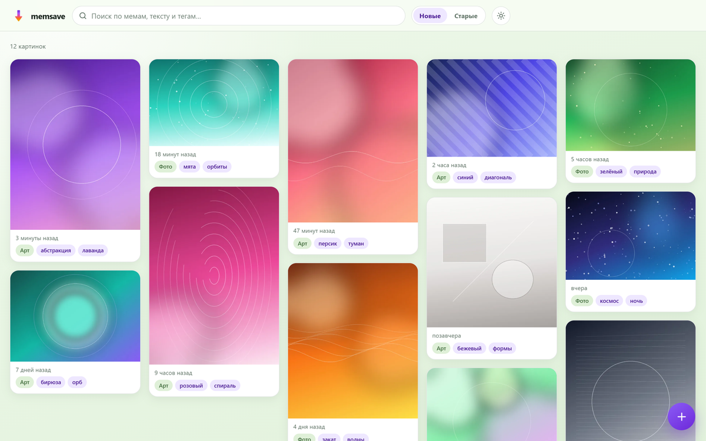

# memsave — личный архив картинок и мемов

Self-hosted архив изображений: вставка из буфера обмена, drag-and-drop, PWA Share Target,
расширение Chrome и ссылки с превью. Каждая картинка быстро сохраняется на диск, а AI
размечает её в фоне: категория, теги, описание и текст с картинки. Поиск — гибридный:
FTS5 + локальные мультиязычные эмбеддинги (RAG-подход, как в duosave).

Сайт сделан в светло-зелёной гамме с фиолетовым акцентом: компактная шапка, masonry-галерея,
относительное время под картинками, теги, лайтбокс и состояние в URL. Админки нет — только
файл базы, папки с картинками и CLI-бэкап.

<p align="center">
  
</p>

## Возможности

- **Быстрое сохранение**: `POST /api/images` принимает сырые байты, считает SHA-256, пишет
  файл и отвечает сразу; AI работает в фоновой очереди.
- **Буфер обмена, drag-and-drop, выбор файла** — базовый сценарий на компьютере.
- **PWA**: установка как приложение, `share_target` с файлами и ссылками.
- **Ссылки**: сервер достаёт картинку из OpenGraph/Twitter Card/JSON-LD, как это делают
  Slack, Telegram и X. Если картинки нет — запись не создаётся.
- **Chrome MV3**: пункт «Отправить в memsave» в контекстном меню на картинке.
- **AI-разметка**: категория, 3–6 русских тегов, короткое описание, весь видимый текст.
- **Поиск**: FTS5/BM25 + fastembed + RRF; фильтр по тегу; состояние в URL.
- **Дедупликация** по SHA-256; HEIC/HEIF и старые форматы конвертируются для браузера.
- **Без админки**: SQLite-база и папки; инкрементальный zip-бэкап из командной строки.
- **Docker + sitehub**: готовый фрагмент Traefik и скрипт обновления с откатом.

## Как это работает

```
браузер / PWA / extension
        │  сырые байты             │  ссылка
        ▼                          ▼
  POST /api/images           POST /api/links
        │                          │
        └──────────────┬───────────┘
                       ▼
              SQLite + data/images
                       │
             очередь jobs (SQLite)
          ┌────────────┼─────────────┐
          ▼            ▼             ▼
      prepare       recognize       embed
   HEIC→JPEG,     vision API      fastembed
   thumbnail      теги + текст    вектор в SQLite
```

Ответ на сохранение не ждёт AI. `prepare` и `recognize` — отдельные воркеры; vision-запросы
не наслаиваются, а ретраи идут с backoff. После рестарта контейнера незавершённые задачи
возвращаются в очередь, а не теряются.

## Быстрый старт

Нужен Python 3.14+.

```bash
python -m pip install -r requirements.txt
cp .env.example .env
# впишите MEMSAVE_VISION_API_KEY (OpenRouter или другой OpenAI-compatible endpoint)
python -m memsave init
python -m memsave serve
```

Сайт: `http://127.0.0.1:8780`.

Без ключа AI сервис всё равно работает: картинки сохраняются, но остаются без тегов
(в лайтбоксе можно нажать «Повторить AI», когда ключ появится).

### Переменные окружения

Основные (`MEMSAVE_*`):

| Переменная | По умолчанию | Назначение |
|---|---|---|
| `MEMSAVE_DATA_DIR` | `./data` | база, картинки, thumbnails, модели, бэкапы |
| `MEMSAVE_VISION_API_KEY` | пусто | ключ vision-провайдера |
| `MEMSAVE_VISION_MODEL` | `deepseek/deepseek-v4.1-flash` | модель |
| `MEMSAVE_VISION_BASE_URL` | `https://openrouter.ai/api/v1` | OpenAI-compatible endpoint |
| `MEMSAVE_VISION_TIMEOUT` | `60` | таймаут vision-запроса, секунды |
| `MEMSAVE_VISION_RETRIES` | `5` | максимум попыток |
| `MEMSAVE_MAX_UPLOAD_MB` | `20` | максимум сырого файла |
| `MEMSAVE_LINK_MAX_IMAGE_MB` | `20` | максимум картинки из ссылки |
| `MEMSAVE_JOBS` | `1` | `0` отключает фоновые воркеры (тесты) |
| `MEMSAVE_EMBEDDING_MODEL` | `sentence-transformers/paraphrase-multilingual-MiniLM-L12-v2` | локальная модель эмбеддингов |
| `MEMSAVE_SEMANTIC_MIN_SCORE` | `0.18` | минимальная cosine-близость для векторной выдачи |
| `MEMSAVE_PORT` | `8780` | host-порт Docker Compose |
| `MEMSAVE_BIND_ADDR` | `10.77.77.21` | VPN-адрес для sitehub |
| `MEMSAVE_HOST_DATA_DIR` | `./data` | host-папка данных Docker |
| `MEMSAVE_REPO_URL` | `https://github.com/northis/memsave` | база для ссылок версии/коммита |

`HOST` и `PORT` задают адрес uvicorn.

Первый запуск эмбеддингов скачивает модель (~240 МБ) в `data/models`; дальше поиск работает
локально. В Docker папка `data` — volume, поэтому модель скачивается один раз.

## Использование

### Компьютер

- `Ctrl+V` на странице — вставить картинку из буфера.
- Перетащить файл в окно.
- Кнопка `+` — выбрать файлы.
- Если вставить ссылку текстом, memsave попробует достать из неё картинку.

### Телефон и PWA

1. Откройте сайт в Chrome Android.
2. Меню → «Установить приложение».
3. В системном меню «Поделиться» появится memsave: можно отправить картинку или ссылку.

На iPhone Safari не поддерживает Web Share Target. Доступны выбор файла и вставка; если нужен
пункт «Поделиться», потребуется отдельный iOS Shortcut и service token Cloudflare Access.

### Ссылки

`POST /api/links` ставит задачу и сразу возвращает `job_id`. Воркер:

- скачивает страницу с браузерным User-Agent;
- читает `og:image`, `twitter:image`, `link rel=image_src`, JSON-LD;
- при отсутствии — повторяет запрос с ботом-User-Agent;
- для X/Twitter есть fallback через oEmbed;
- скачивает первую валидную картинку с `Referer` страницы;
- блокирует private/loopback/link-local адреса, ограничивает редиректы, размер и время.

Если картинки нет, задача завершается ошибкой, а в архиве ничего не появляется.

### Chrome extension

```text
chrome://extensions/ → Режим разработчика → Загрузить распакованное → extension/
```

В настройках расширения укажите адрес сервера, сохраните (это запросит доступ к домену) и,
если нужно, разрешите доступ к сайтам картинок. При правом клике на картинке появится
«Отправить в memsave». Если сайт не отдаёт файл расширению, запрос уходит на серверный
link-preview fallback.

### Теги и поиск

- Под картинкой: категория и 2 тега (остальные — по `+N` или в лайтбоксе).
- Клик по тегу → `?tag=...`, отдельная выборка; работает вместе с поиском.
- Поиск: FTS5 по описанию/тексту/тегам + векторная близость; результаты объединяются RRF.
  Если эмбеддингов ещё нет, показывается текстовый поиск.
- `?sort=new|old`, `?q=...`, `?tag=...`, `?image=<id>` — всё отражается в URL и работает
  с кнопкой «Назад».

## Данные и бэкап

```text
data/
  memsave.db        SQLite (WAL)
  images/           оригиналы и JPEG-копии HEIC
  thumbs/           WebP-миниатюры
  backups/          zip-бэкапы
  models/           скачанная модель эмбеддингов
```

Инкрементальный бэкап:

```bash
python -m memsave backup
python -m memsave backup --full
```

В Docker базу нужно бэкапить **внутри контейнера**, чтобы не читать WAL через bind mount:

```bash
docker compose exec memsave python -m memsave backup
```

Zip содержит `memsave.db` и изменённые файлы `images/` и `thumbs/`. Состояние последнего
бэкапа лежит в `backups/backup_state.json`. Для восстановления распакуйте zip в `data/`
(или в host-папку, смонтированную в `/data`) и перезапустите сервис.

Другие команды:

```bash
python -m memsave init            # создать БД и папки
python -m memsave serve           # сайт
python -m memsave reindex         # пересчитать эмбеддинги
python -m memsave reindex --full  # пересчитать всё
python -m memsave retry-failed    # вернуть в очередь картинки с ошибкой AI
python -m memsave stats           # статистика
python -m memsave version         # версия и коммит
```

## Docker

```bash
cp .env.example .env
docker compose up -d --build
docker compose ps
docker compose logs -f memsave
```

Сервис публикуется на `127.0.0.1:8780` (для локального браузера/расширения) и на
`${MEMSAVE_BIND_ADDR}:8780` (по умолчанию `10.77.77.21` — для sitehub через SoftEther VPN).
Админского порта нет.

## sitehub и Cloudflare Access

1. На Ubuntu-хосте добавьте `deploy/sitehub/memsave.yml` в
   `traefik/dynamic/vpn-sites.yml`, заменив домен и VPN-адрес. Traefik подхватит файл без
   перезапуска.
2. В Cloudflare Access создайте Bypass-политику для PWA-путей:
   `/manifest.webmanifest`, `/static/favicon.svg`, `/static/icons/*`.
3. Проверьте:

```bash
curl -s -o /dev/null -w '%{http_code}\n' https://memsave.<домен>/manifest.webmanifest
curl -s -o /dev/null -w '%{http_code}\n' https://memsave.<домен>/static/icons/icon-192.png
curl -s -o /dev/null -w '%{http_code}\n' https://memsave.<домен>/          # без сессии: редирект/401
```

Traefik-фрагмент содержит два router'а: основной с `cf-access-verify@file` и `memsave-pwa`
без проверки JWT для manifest/icons. Оба уровня (Access Bypass и Traefik) нужны независимо:
Android-установщик WebAPK скачивает manifest/icons без сессии.

### Если `/static/favicon.svg` отдаёт 401 `missing Cf-Access-Jwt-Assertion`

Это не ошибка проброса заголовка. Для Bypass-путей Cloudflare Access специально **не**
добавляет `Cf-Access-Jwt-Assertion`, поэтому запрос должен идти в обход
`cf-access-verify@file`. Если ошибка есть, значит verifier всё ещё применяется:

1. В `.env` sitehub должно быть `CF_ACCESS_VERIFY_GLOBAL=false`. В глобальном режиме
   middleware висит на entrypoint и применяется даже к `memsave-pwa`. После изменения:
   `docker compose up -d` (Traefik пересоздастся).
2. В `traefik/dynamic/vpn-sites.yml` основной router `memsave` должен иметь
   `middlewares: [cf-access-verify@file]`, а `memsave-pwa` — **не** иметь middleware,
   с `priority: 100` и rule из `deploy/sitehub/memsave.yml` (включая
   `Path('/static/favicon.svg')`).
3. В Cloudflare Access Bypass должны быть все три пути:
   `/manifest.webmanifest`, `/static/favicon.svg`, `/static/icons/*`.

`authRequestHeaders` в `access-verify.yml` уже содержит `Cf-Access-Jwt-Assertion`; для
Bypass-путей его прокидывать не нужно и нельзя — их надо именно исключить из проверки.

## Версии и релизы

Единый источник версии — `memsave/__init__.py`; `tools/bump_version.py` синхронизирует её с
`extension/manifest.json`.

```bash
python -m pip install -r requirements-tools.txt   # Playwright для иконок
python tools/bump_version.py 0.2.0
python tools/bump_version.py --check
python tools/make_icons.py          # перерисовать PNG из tools/icon.svg (нужен Chrome)
git tag -a v0.2.0 -m "memsave 0.2.0"
git push --follow-tags origin master
```

`/api/version` отдаёт версию, commit, short, commit_url, tag, tag_url; шапка сайта показывает
`vX.Y.Z` и короткий коммит (со `*`, если рабочая копия грязная).

Обновление на Windows-хосте:

```powershell
powershell -ExecutionPolicy Bypass -File deploy\windows\update.ps1
powershell -ExecutionPolicy Bypass -File deploy\windows\update.ps1 -Rollback
```

Скрипт делает fetch/ff-only, бэкап, сборку из чистого worktree, тег `memsave:previous`,
ждёт новый commit в `/api/version` и откатывается при неудаче.

## Тесты

```bash
python -m pip install -r requirements-dev.txt
python -m pytest -q
node --check memsave/server/static/app.js
node --check memsave/server/static/sw.js
node --check extension/background.js
node --check extension/options.js
```

Тесты офлайн: временная `MEMSAVE_DATA_DIR`, `MEMSAVE_JOBS=0`, подменённые vision/embedder
и локальные HTML-фикстуры. Реальные AI-ключи и Docker в тестах не нужны.

## Ограничения и заметки

- Vision-модель получает уменьшенную JPEG-копию (до 1536 px), поэтому большие фото не
  отправляются целиком.
- Локального OCR нет: текст извлекает vision-модель. При ошибке AI картинка сохраняется,
  теги можно получить повторным запуском.
- Поддерживаются JPEG, PNG, WebP, GIF, HEIC/HEIF, AVIF и то, что умеет Pillow; SVG
  отклоняется как небезопасный.
- Ссылки ограничены http/https и портами 80/443; приватные адреса блокируются.
- В `images/` могут лежать и оригиналы HEIC, и JPEG-копии для браузера.
- Лайков/рейтингов нет; есть удаление и повтор AI.
- Сервис не содержит собственной авторизации: внешний вход — Cloudflare Access через sitehub.

## Структура

| Путь | Что там |
|---|---|
| `memsave/` | пакет: конфиг, БД, медиа, AI, очередь, поиск, бэкап, CLI |
| `memsave/server/` | FastAPI и статика (vanilla JS/CSS, PWA) |
| `extension/` | Chrome MV3: контекстное меню и настройки |
| `deploy/sitehub/memsave.yml` | фрагмент Traefik |
| `deploy/windows/update.ps1` | обновление с бэкапом и откатом |
| `tools/` | иконки и bump версии |
| `tests/` | офлайн pytest |
| `Dockerfile`, `docker-compose.yml` | образ и запуск |
| `.env.example` | шаблон конфигурации |
